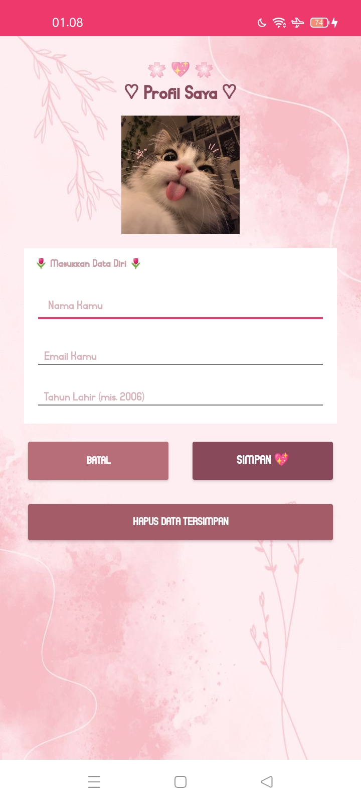
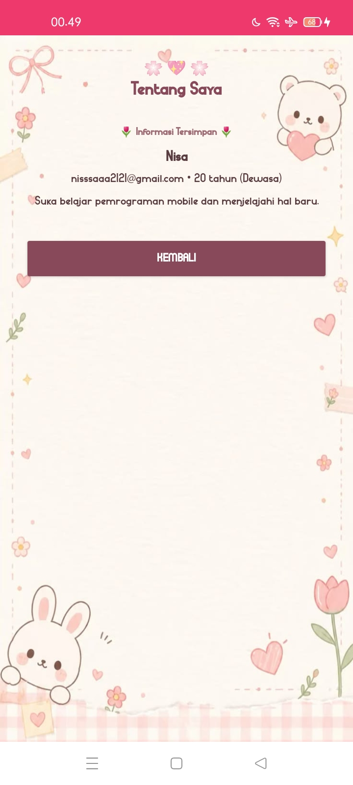
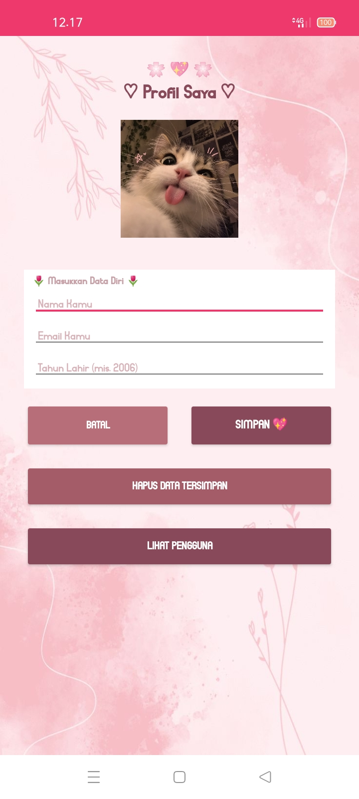
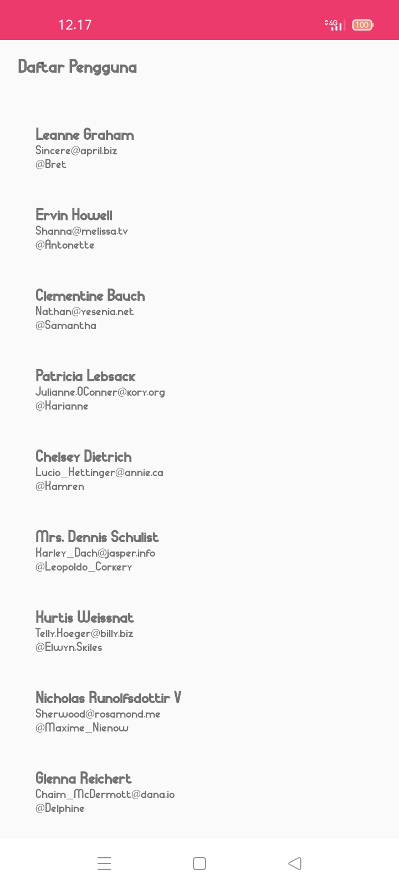
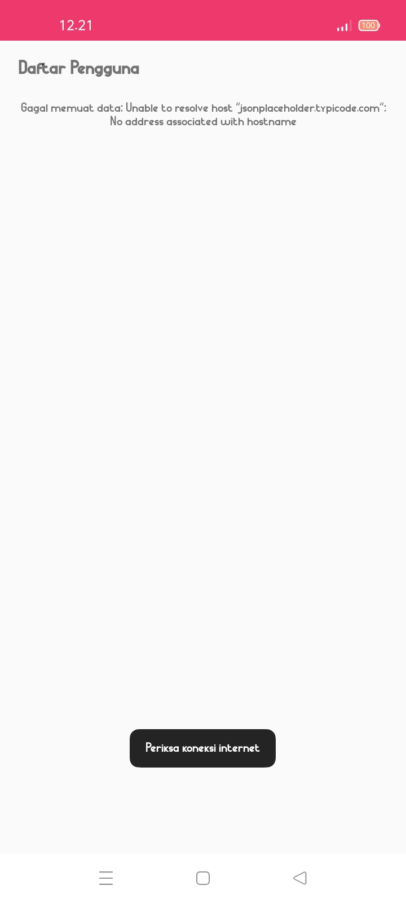

# Proyek Kartu Profil — Pertemuan 9 & 10

Aplikasi Android **Kartu Profil** (`com.example.belajarmobile`) yang dikembangkan menggunakan **Kotlin**, **XML layout**, **Android Studio**, dan **Gradle**. Pada pengembangan Pertemuan 9 dan 10, proyek ini mencakup fitur kartu profil, penyimpanan data lokal (**SharedPreferences** dan database **Room**), serta pengambilan data daftar pengguna dari internet menggunakan REST API (**Retrofit** + **RecyclerView**).

## Teknologi & Komponen Utama
* **Bahasa & UI**: Kotlin dan XML layout (`activity_main.xml`, `activity_second.xml`, `activity_user_list.xml`, `item_user.xml`, serta resource drawable/layout lainnya).
* **Penyimpanan Lokal**: **SharedPreferences** (penyimpanan preferensi data profil terakhir) dan database lokal **Room** (`AppDatabase.kt`, entitas `Catatan.kt`).
* **Jaringan & Daftar Data**: **Retrofit**, konverter **Gson**, dan **RecyclerView** (`ApiService.kt`, `RetrofitClient.kt`, `UserAdapter.kt`, `UserListActivity.kt`).
* **Lingkungan Pengembangan**: Android Studio dengan build sistem Gradle.

## Fitur Utama & Alur Pengujian
* **Form Profil & Validasi**: Mengisi data diri (Nama, Email, Tahun Lahir), membersihkan input lewat tombol **Batal**, menghapus data tersimpan lewat tombol **Hapus Data Tersimpan**, dan menyimpan data ke layar berikutnya (**Tentang Saya**).
* **Buka Ulang Aplikasi**: Menutup lalu membuka kembali aplikasi untuk memastikan data tersimpan lokal muncul otomatis dan dapat dikelola kembali.
* **Daftar Pengguna (Retrofit & RecyclerView)**: Membuka halaman **Daftar Pengguna** lewat tombol **Lihat Pengguna** (`UserListActivity`), mengambil data dari endpoint `https://jsonplaceholder.typicode.com/users` menggunakan Retrofit + Gson, lalu menampilkannya di `RecyclerView`.
* **Penanganan Kondisi Online / Offline**: Menampilkan daftar pengguna saat internet aktif (`onResponse`), serta menampilkan pesan gagal memuat dan `Toast` `"Periksa koneksi internet"` tanpa *crash* saat mode pesawat / tidak ada koneksi (`onFailure`).

## Dokumentasi Tangkapan Layar
1. **Tampilan Awal Form Profil (Kosong)**  
     
   Tampilan awal halaman **Profil Saya** dengan tombol **Batal**, **Simpan**, dan **Hapus Data Tersimpan** saat kolom input masih kosong.

2. **Pengisian Form Data Diri**  
     
   Formulir **Profil Saya** setelah diisi data (`Nisa`, `nisssaaa2121@gmail.com`, tahun lahir `2006`).

3. **Halaman Kedua — Tentang Saya**  
     
   Menampilkan informasi tersimpan (`Nisa`, email, dan hasil olahan `20 tahun (Dewasa)`) beserta tombol **Kembali**.

4. **Data Tersimpan Saat Aplikasi Dibuka Ulang**  
     
   Saat aplikasi dibuka kembali, data tersimpan (`Nisa` dan `nisssaaa2121@gmail.com`) muncul kembali otomatis.

5. **Tampilan Profil dengan Tombol Lihat Pengguna**  
     
   Tampilan halaman **Profil Saya** yang sudah memiliki tombol **Lihat Pengguna** untuk membuka daftar pengguna dari API.

6. **Daftar Pengguna (Mode Online)**  
     
   Halaman **Daftar Pengguna** saat koneksi internet aktif, menampilkan data pengguna (`Leanne Graham`, `Ervin Howell`, `Clementine Bauch`, dst.).

7. **Daftar Pengguna (Mode Offline / Tanpa Koneksi)**  
     
   Halaman **Daftar Pengguna** saat mode pesawat / tidak ada internet, menampilkan pesan gagal memuat (`Unable to resolve host "jsonplaceholder.typicode.com"`) dan `Toast` `"Periksa koneksi internet"`.

## Tujuan & Perbedaan Penyimpanan Lokal (SharedPreferences vs Room)
Tujuan bagian ini adalah menjelaskan fungsi dua pendekatan penyimpanan lokal yang digunakan di aplikasi agar jelas kapan masing-masing dipakai:

| Aspek | SharedPreferences | Room Database (`AppDatabase.kt` & `Catatan.kt`) |
| :--- | :--- | :--- |
| **Bentuk Data** | Pasangan kunci–nilai (*key–value*) sederhana | Tabel terstruktur berbasis SQLite (`@Entity(tableName = "catatan")`) |
| **Kegunaan di Proyek** | Menyimpan data profil terakhir agar bisa dimuat ulang saat aplikasi dibuka kembali dan dihapus lewat tombol **Hapus Data Tersimpan** | Menyimpan dan mengelola data catatan lokal secara terstruktur di database lokal |
| **Pola Pembaruan** | Menimpa nilai pada kunci yang sama | Menambah/mengelola baris data terstruktur pada tabel |
| **Kebutuhan Komponen** | Ringkas, cukup objek `SharedPreferences` dan editor (`edit()...apply()`) | Memerlukan *Entity* (`Catatan.kt`), *DAO*, dan *Database* (`AppDatabase.kt`) |
| **Kapan Dipilih** | Data preferensi ringan tunggal yang sering dibaca cepat | Data terstruktur atau banyak entri yang butuh pengelolaan rapi berbasis tabel |

## Cara Menjalankan Aplikasi
1. Buka folder proyek (`proyek-kartu-profil-p4-p6` / `com.example.belajarmobile`) di **Android Studio**.
2. Tunggu proses *Gradle sync* selesai hingga tidak ada *error* konfigurasi.
3. Hubungkan HP Android (dengan *USB debugging* aktif) atau jalankan emulator di Android Studio (seperti *Medium Phone*).
4. Klik tombol **Run** (ikon *play* hijau) di Android Studio untuk membangun (*build*) dan menginstal aplikasi ke perangkat/emulator.
