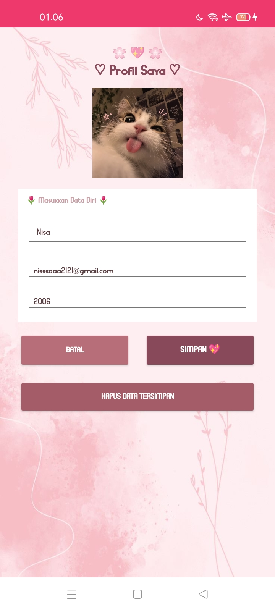
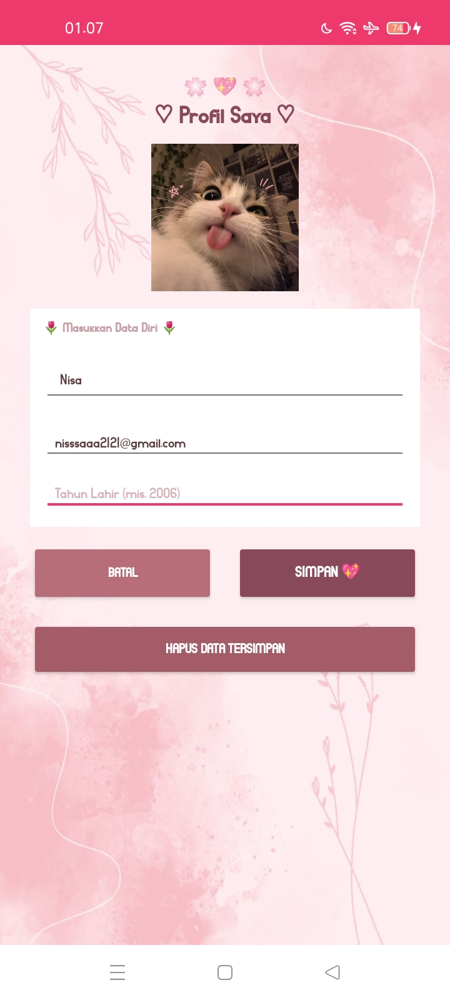

# Proyek Kartu Profil — Pertemuan 9 & 10

Aplikasi Android **Kartu Profil** (`com.example.belajarmobile`) yang dikembangkan menggunakan **Kotlin**, **XML layout**, **Android Studio**, dan **Gradle**. Pada pengembangan Pertemuan 9 dan 10, proyek ini mencakup fitur kartu profil, penyimpanan data lokal (**SharedPreferences**), serta pengambilan data daftar pengguna dan kutipan dari internet menggunakan REST API (**Retrofit** + **RecyclerView**).

## Teknologi & Komponen Utama
- **Bahasa & UI**: Kotlin dan XML layout (`activity_main.xml`, `activity_second.xml`, `activity_user_list.xml`, `item_user.xml`, `activity_quote_list.xml`, `item_quote.xml`, serta resource drawable/layout lainnya).
- **Penyimpanan Lokal**: **SharedPreferences** (berkas `"profil"`, `MODE_PRIVATE`) untuk menyimpan preferensi data profil terakhir.
- **Jaringan & Daftar Data**: **Retrofit**, konverter **Gson**, dan **RecyclerView** (`ApiService.kt`, `RetrofitClient.kt`, `User.kt`, `UserAdapter.kt`, `UserListActivity.kt`, `Quote.kt`, `QuotesResponse`, `QuoteAdapter.kt`, `QuoteListActivity.kt`).
- **Lingkungan Pengembangan & Stack**: Android Studio dengan build sistem Gradle (`com.example.belajarmobile`, Min SDK 24, Target/Compile SDK 34, Gradle 8.7, AGP 8.5.2, Kotlin 2.0.20, AppCompat 1.7.0, Retrofit 2.9.0, converter-gson 2.9.0, RecyclerView 1.3.2).

## Yang Baru di Pertemuan 9 & 10
- **Penyimpanan dengan `SharedPreferences`**: Setelah validasi form lolos dan sebelum berpindah layar (`startActivity`), data profil terakhir disimpan ke berkas `"profil"` (`MODE_PRIVATE`) menggunakan kunci konstanta di `companion object` (`PREFS_PROFIL`, `KEY_NAMA_TERAKHIR`, `KEY_EMAIL_TERAKHIR`, `KEY_TAHUN_LAHIR_TERAKHIR`, `KEY_UMUR_TERAKHIR`, `KEY_KATEGORI_TERAKHIR`) dengan `apply()`.
- **Membaca Kembali Saat Aplikasi Dibuka**: Di `onCreate` pada `MainActivity`, nilai tersimpan dibaca ulang dari `SharedPreferences` sehingga kolom input (`etNama`, `etEmail`, `etTahunLahir`) dapat terisi otomatis bila data tersedia, atau tetap kosong bila belum ada data.
- **Tombol Hapus Data Tersimpan (`btnHapusSimpan`)**: Menghapus seluruh kunci pada berkas `"profil"` lewat `prefs.edit().clear().apply()`, mengosongkan kolom input dan pesan error, serta menampilkan `Toast` `"Data tersimpan dihapus"`.
- **Dua Tombol Daftar dari Internet (Pertemuan 10)**: Menambahkan tombol **Lihat Pengguna** (`btnLihatPengguna` → `UserListActivity`) dan **Lihat Kutipan** (`btnLihatKutipan` → `QuoteListActivity`) pada layar utama.

## Fitur Utama & Alur Pengujian
- **Form Profil & Validasi**: Mengisi data diri (**Nama**, **Email**, **Tahun Lahir**), membersihkan kolom lewat tombol **Batal**, menghapus data tersimpan lewat **Hapus Data Tersimpan**, dan mengirim data ke layar **Tentang Saya** (`SecondActivity`) beserta perhitungan umur dan kategori (`Anak` 0–12, `Remaja` 13–17, `Dewasa` 18–59, `Lansia` 60+).
- **Buka Ulang Aplikasi & Reset Data**: Menutup aplikasi sepenuhnya lalu membukanya kembali untuk memastikan data lokal tetap tersimpan, serta menguji penghapusan data lewat tombol **Hapus Data Tersimpan** maupun pengaturan aplikasi di perangkat.
- **Daftar Pengguna (JSONPlaceholder + Retrofit & RecyclerView)**: Membuka `UserListActivity` lewat tombol **Lihat Pengguna** untuk mengambil data dari `https://jsonplaceholder.typicode.com/users` (`@GET("users")`) menggunakan `enqueue` (callback) dan menampilkannya di `RecyclerView`.
- **Daftar Kutipan (DummyJSON + Retrofit & RecyclerView)**: Membuka `QuoteListActivity` lewat tombol **Lihat Kutipan** untuk mengambil data dari API DummyJSON (`@GET("quotes?limit=10")` melalui `RetrofitClient.quoteApi`) dan menampilkannya di `RecyclerView` dengan judul **Daftar Kutipan**.
- **Tiga Keadaan Layar & Kondisi Online / Offline**:
  - **Memuat**: `ProgressBar` tampil dan status menunjukkan proses memuat data.
  - **Sukses (`onResponse`, kode 2xx)**: `ProgressBar` disembunyikan dan daftar data tampil di `RecyclerView`. Jika respons server bukan 2xx, ditangani di `onResponse` dengan menampilkan kode status agar `ProgressBar` tidak berputar terus.
  - **Gagal (`onFailure` / mode pesawat)**: `ProgressBar` disembunyikan, pesan gagal memuat ditampilkan, dan `Toast` `"Periksa koneksi internet"` muncul tanpa membuat aplikasi *crash*.

## Eksplorasi API Pilihan Sendiri (DummyJSON Quotes)
- **Endpoint & Akses**: `GET https://dummyjson.com/quotes?limit=10` (gratis, tanpa API key, berbasis HTTPS).
- **Alasan Pemilihan**: Konten utamanya berupa teks kutipan dan penulis sehingga tidak memerlukan library pemuat gambar tambahan, dan polanya selaras dengan alur `UserListActivity` (`Retrofit`, `Gson`, `enqueue`, `RecyclerView`).
- **Kendala & Solusi**: Berbeda dari JSONPlaceholder yang mengembalikan array JSON langsung di tingkat atas (`Call<List<User>>`), DummyJSON membungkus daftar kutipan di dalam objek `{"quotes": [...]}`. Solusinya menggunakan model pembungkus `QuotesResponse` (`Call<QuotesResponse>`) lalu meneruskan `response.body()?.quotes` ke `QuoteAdapter`.

## Dokumentasi Tangkapan Layar
1. **Tampilan Awal Form Profil (Kosong)**  
     
   Aplikasi baru dibuka dan belum ada data tersimpan; kolom Nama, Email, dan Tahun Lahir kosong dengan tombol **Batal**, **Simpan**, dan **Hapus Data Tersimpan**.

2. **Pengisian Form Data Diri**  
     
   Formulir **Profil Saya** setelah diisi data (`Nisa`, `nisssaaa2121@gmail.com`, tahun lahir `2006`) lalu menekan **Simpan**.

3. **Halaman Kedua — Tentang Saya**  
     
   Menampilkan informasi profil dan hasil olahan (`20 tahun • Dewasa`) pada layar **Tentang Saya**.

4. **Data Tersimpan Saat Aplikasi Dibuka Ulang**  
     
   Setelah aplikasi ditutup dan dibuka kembali, data tersimpan dari `SharedPreferences` terbaca kembali secara otomatis.

5. **Layar Pertemuan 10 (Tombol Lihat Pengguna & Lihat Kutipan)**  
     
   Halaman utama **Profil Saya** yang sudah dilengkapi tombol **Lihat Pengguna** (`btnLihatPengguna`) dan **Lihat Kutipan** (`btnLihatKutipan`).

6. **Daftar Pengguna (Mode Online)**  
     
   Halaman **Daftar Pengguna** saat koneksi aktif, menampilkan daftar pengguna dari JSONPlaceholder (`Leanne Graham`, `Sincere@april.biz`, `@Bret`, dst.).

7. **Daftar Pengguna (Mode Offline / Tanpa Koneksi)**  
     
   Halaman **Daftar Pengguna** saat mode pesawat aktif, menampilkan pesan gagal memuat dan `Toast` `"Periksa koneksi internet"` tanpa *crash*.

8. **Layar Lihat Kutipan (DummyJSON)**  
     
   Halaman **Daftar Kutipan** saat koneksi aktif, menampilkan judul **Daftar Kutipan** beserta daftar kutipan dan penulisnya dari DummyJSON.

## SharedPreferences vs Room & Lokal vs REST API

| Aspek | SharedPreferences | Room Database |
| :--- | :--- | :--- |
| **Bentuk Data** | Pasangan kunci–nilai (*key–value*) sederhana | Tabel terstruktur berbasis SQLite (`@Entity`, `@Dao`, `@Database`) |
| **Kegunaan / Contoh** | Menyimpan data profil terakhir (`nama_terakhir`, `email_terakhir`, `tahun_lahir_terakhir`, `umur_terakhir`, `kategori_terakhir`) | Menyimpan banyak baris data terstruktur (misalnya tabel catatan pada latihan terpisah) |
| **Saat Disimpan Ulang** | Menimpa nilai pada kunci yang sama | Menambah baris baru terstruktur |
| **Pencarian / Pengurutan** | Tidak tersedia | Tersedia melalui query SQL (`WHERE`, `ORDER BY`) |
| **Kecocokan di Proyek** | Cocok untuk mengingat satu profil terakhir secara ringan tanpa kebutuhan tabel atau query | Disarankan bila aplikasi perlu menyimpan banyak profil/riwayat yang perlu dicari atau diurutkan |

| Aspek | Penyimpanan Lokal (`SharedPreferences`) | Data Internet (`REST API` + `Retrofit`) |
| :--- | :--- | :--- |
| **Asal Data** | Tersimpan di memori aplikasi pada perangkat | Diambil dari server melalui jaringan internet |
| **Tanpa Internet** | Data tetap tersedia | Gagal dimuat (`onFailure`), menampilkan pesan error dan `Toast` |
| **Buka Ulang Aplikasi** | Data tersimpan tetap ada | Meminta ulang data terbaru ke server saat layar dibuka |
| **Contoh di Proyek Ini** | Data profil terakhir | Daftar pengguna (`UserListActivity`) dan daftar kutipan (`QuoteListActivity`) |

## Cara Menjalankan Aplikasi
1. Buka folder proyek (`com.example.belajarmobile`) di **Android Studio** (atau terminal pada folder akar proyek yang memiliki `gradlew.bat`).
2. Pastikan koneksi internet aktif saat *Gradle sync* / build pertama untuk mengunduh dependensi Gradle & library.
3. Hubungkan perangkat Android fisik (dengan *USB debugging* aktif) atau jalankan emulator di Android Studio, lalu pastikan perangkat terbaca (`adb devices`).
4. Klik tombol **Run** di Android Studio (atau jalankan `.\gradlew installDebug` di PowerShell). Jika muncul pesan *"SDK location not found"*, tambahkan berkas `local.properties` di folder akar proyek berisi `sdk.dir=<path_sdk_anda>`.
5. 
